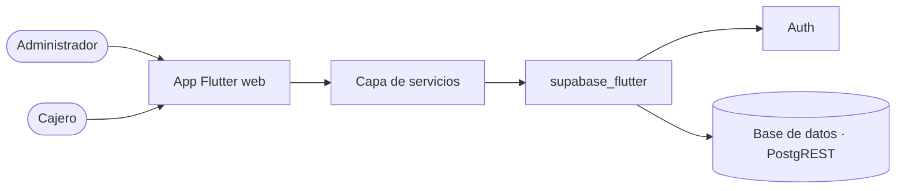

# Architectural spine · NevaraFresh

## Resumen

NevaraFresh es una app de inventario y punto de venta para las tiendas de una cadena de supermercados, con dos roles: administrador y cajero. Corre en el navegador de un computador. El backend es Supabase, que da la autenticación y la base de datos.

## Diagrama

## Stack

- Frontend: Flutter 3.x y Dart 3.x. Plataforma: web, en computador.
- SDK: `supabase_flutter`.
- Backend: Supabase con Auth y base de datos (Postgres + PostgREST).

## Qué cubre cada servicio

- **Auth**: inicio y cierre de sesión con correo y contraseña. Las cuentas de demostración del administrador y del cajero también son cuentas de Auth.
- **Base de datos**: tiendas, usuarios con su rol y su tienda, categorías, productos, inventario por tienda, ventas con su detalle y reposiciones (detalle en `docs/modelo.md`).

## Invariantes

### AD-01 · Sin backend propio

- **Regla:** la app habla directo con Supabase.
- **Evita:** que alguien monte un servidor aparte para una sola funcionalidad.

### AD-02 · Una capa de servicios

- **Regla:** solo los servicios de la app llaman a Supabase; las Screens les piden los datos a los servicios.
- **Evita:** consultas repetidas y distintas a la misma tabla regadas por la app.

### AD-03 · El usuario es el de Auth

- **Regla:** el usuario de la base de datos se identifica con el id de su cuenta de Auth, y ahí se guardan su rol y su tienda.
- **Evita:** dos identidades para la misma persona.

### AD-04 · El rol decide el acceso

- **Regla:** después de iniciar sesión se lee el rol del usuario y la navegación muestra solo los destinos de ese rol. El cajero solo trabaja con datos de su tienda.
- **Evita:** que un cajero entre al resumen de la cadena o al inventario de otra tienda.

### AD-05 · Las existencias viven solo en el inventario

- **Regla:** las existencias de un producto en una tienda están en una sola fila de inventario. Una venta resta y una reposición suma sobre esa fila; el producto no guarda existencias.
- **Evita:** que dos lugares digan cantidades distintas para el mismo producto en la misma tienda.

### AD-06 · Una venta se registra completa

- **Regla:** la venta, sus detalles y el descuento de existencias se guardan juntos; si algo falla, no se guarda nada.
- **Evita:** ventas registradas sin descontar inventario, o inventario descontado sin venta.

### AD-07 · El estado vive en la Screen anfitriona

- **Regla:** cada Screen guarda los datos de su parte de la app; las Pages y los componentes los reciben y avisan los cambios hacia arriba.
- **Evita:** copias de los mismos datos en distintas partes de la interfaz que se desincronizan.

### AD-08 · Llaves fuera del código

- **Regla:** la URL y la publishable key se leen de la configuración, no se escriben en cada archivo. La secret key nunca va en la app ni en el repositorio.
- **Evita:** cambiar de proyecto editando diez archivos, o exponer la llave secreta.

## Diferido

- **Storage**: no se usa; los productos no tienen foto. Se decide si se agregan fotos de producto.
- **Seguridad por filas (RLS)**: el curso la deja por fuera; el acceso por rol se controla en la app (AD-04).
- **Realtime**: una venta de otra caja se ve al volver a consultar, no al instante.

## Historial

- 0.1.0 · 2026-11-07 · Primera versión.
